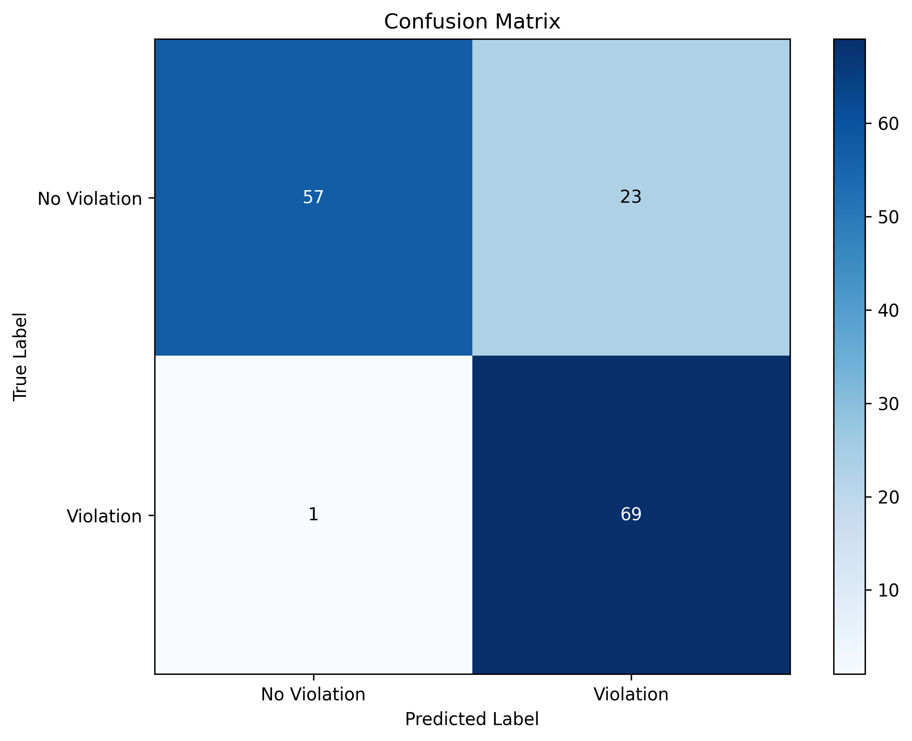
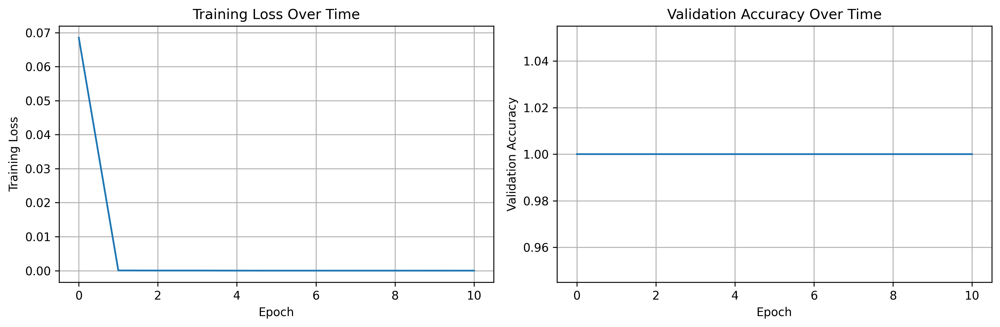

# Cross-Cultural Communication Scenario Evaluation

Can a language model tell when a conversation between two people from different cultures goes wrong? This project tests that question in two ways:

1. **Zero-shot:** ask GPT models directly whether a scenario contains a cross-cultural communication norm violation.
2. **Neural probe:** extract GPT-2 embeddings for each scenario and train a small MLP classifier on them, to see how much of this signal is already inside the model's representations.

Scenarios vary the nationality, age group and gender of both people, and each one is labeled *violation* or *no violation*. The labeled scenarios build on the dataset from Weng et al. (UMAP '25).

## Results (MLP probe on GPT-2 embeddings)

Test set: 150 scenarios (70 / 15 / 15 train / validation / test split, seed 42).

| Metric | Value |
| --- | --- |
| Accuracy | 0.84 |
| Precision | 0.75 |
| Recall | 0.99 |
| F1 | 0.85 |
| Specificity | 0.71 |

The probe almost never misses a real violation (69 of 70 found), but it over-flags: 23 of 80 normal scenarios were marked as violations. In other words, the embeddings carry a strong signal, and the next step is reducing false alarms.




## How it works

`train.py` runs the full pipeline:

1. Load a scenario CSV and split it into train, validation and test sets.
2. Extract an embedding for each scenario from GPT-2 (`openai-community/gpt2`), using the last token's final hidden state, and cache them in `embeddings_cache.pt`.
3. Train an MLP probe (hidden size 128, dropout 0.3, Adam, learning rate 1e-3, up to 50 epochs), keeping the best checkpoint by validation accuracy in `best_probe.pt`.
4. Report accuracy, precision, recall, F1 and specificity in `results.json`, and save the plots.

Batch size and network size adjust automatically to the dataset size.

## Run it

```bash
python -m venv .venv && source .venv/bin/activate
pip install -r requirements.txt
python train.py
```

To use a different scenario file, change `DATASET_PATH` in the `Config` class at the top of `train.py`. The `results_*.csv` files hold scenario sets of different sizes (500 to 1,800).

Runs on CPU or Apple Silicon (MPS).

## Files

| File | What it is |
| --- | --- |
| `train.py` | Data loading, embedding extraction, probe training and evaluation |
| `results_*.csv` | Generated scenario sets with model answers and labels |
| `results.json` | Test metrics for the latest run |
| `best_probe.pt` | Trained probe weights |
| `confusion_matrix.png`, `training_curves.png` | Plots from the latest run |
